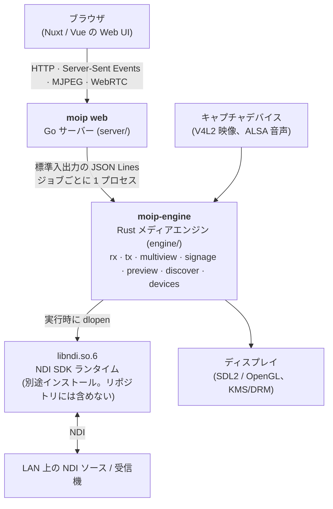

# moip-toolkit

[English](README.md) | **日本語**

[NDI](https://ndi.video/) を活用することで、DJイベント "The Utopia Tone" の映像伝送をIPネットワーク上に移行します。
NDIソースを最小限の遅延で受信して全画面表示するほか、キャプチャデバイスのNDI送信、複数ソースのマルチビュー表示、静止画のデジタルサイネージ表示ができます。いずれもブラウザUIやREST APIから遠隔操作できます。

## アーキテクチャ



- **engine/**（Rust）が映像・音声処理をすべて担当します。NDI SDKを直接呼び出すので、インタプリタのロックも、受信経路でのFrameSyncによるバッファリングもありません。届いたフレームはすぐにGPUへ転送し、UYVY→RGBの変換はシェーダで行います。止まった受信機はその場で新しいものに差し替え、古いものはバックグラウンドのスレッドで破棄します。
- **server/**（Go）はWeb UIとAPIを提供し、エンジンのプロセスを起動・停止します。ブラウザ向けのプレビュー（[pion](https://github.com/pion/webrtc) によるWebRTCのH.264と、フォールバックのMJPEG）は再エンコードせずに中継します。
- **frontend/**（Nuxt 3 / Vue 3）はブラウザUIです。

## 必要なもの

- Linux（x86_64 または arm64）
- NDI SDK のランタイム `libndi.so.6`（[NDI SDK のインストール](#ndi-sdk-のインストール)を参照）
- `avahi-daemon`（mDNSでNDIソースを検出するため）
- ビルドに必要なもの：Rust（stable。[rustup](https://rustup.rs/) で導入）、Go 1.24以上、C/C++コンパイラ、SDL2とALSAの開発用ヘッダ
- Web UIのビルドに必要なもの：Node.js 20以上

```bash
# Debian / Ubuntu
$ sudo apt install git curl build-essential pkg-config libsdl2-dev libasound2-dev avahi-daemon
# Fedora
$ sudo dnf install git curl gcc gcc-c++ pkgconf SDL2-devel alsa-lib-devel avahi
```

## NDI SDK のインストール

NDI SDKはVizrt NDI ABのライセンスで提供されているため、**このリポジトリにコミットしないでください**。ランタイムライブラリは、各マシンにそれぞれインストールします。moip-toolkitは起動時に `libndi.so.6` を読み込むので、ビルド自体にSDKは不要です。

同梱のスクリプトでインストールします。このスクリプトは [DistroAV の `libndi-get.sh`](https://github.com/DistroAV/DistroAV/blob/master/CI/libndi-get.sh) をもとにしています。

```bash
$ scripts/install-ndi-sdk.sh
```

スクリプトが行うこと：

1. 公式のインストーラを `https://downloads.ndi.tv/SDK/NDI_SDK_Linux/Install_NDI_SDK_v6_Linux.tar.gz` からダウンロードします。
2. NDI SDKのライセンスを表示し、同意を求めます。
3. CPUに合った `libndi.so.6*`（x86_64、またはarm64では `lib/aarch64-*` のもの）を `sudo` で `/usr/local/lib` にコピーします。そのディレクトリがリンカの検索対象になっていない場合（Fedora / RHEL）は `ldconfig` に登録し、最後に `ldconfig` を実行します。

環境変数で指定できるオプション：

| 変数 | 説明 |
|---|---|
| `PREFIX=/opt/ndi` | `/usr/local/lib` の代わりに `$PREFIX/lib` にインストールする |
| `NDI_ACCEPT_LICENSE=yes` | 確認なしでライセンスに同意する。既にライセンスを読んで同意している場合（複数台のセットアップなど）だけ使ってください |

ランタイムが見つかることを確認します（[ビルド](#ビルド)の後に実行します）。

```bash
$ ./bin/moip version
NDI SDK LINUX ... 6.x.x
```

システム全体にインストールしたくない場合は、`NDI_RUNTIME_DIR_V6` に `libndi.so.6` のあるディレクトリを指定してください。

## ビルド

```bash
$ git clone https://github.com/TechnoTUT/moip-toolkit.git
$ cd moip-toolkit
$ make            # bin/moip（サーバーとCLI）と bin/moip-engine をビルド
$ make frontend   # Web UI を frontend/.output/public にビルド
```

`make test` でRustとGoのテストを実行できます。

## 使い方

`moip` コマンドが唯一の入口です。`moip web` でサーバーを起動します。それ以外のサブコマンドはメディアエンジンを直接実行します。各サブコマンドに `-h` を付けると、オプションの一覧を表示できます。

### 1. Web UI / REST API

```bash
$ ./bin/moip web --host 0.0.0.0 --port 8000
```

- ブラウザ操作画面：`http://<ホスト>:8000/`
- UIでは、ソースの検出、RXの開始と切り替え、TXの開始と停止、マルチビューとサイネージの操作、ブラウザでのプレビュー、プリセットと自動起動の設定ができます。
- 設定は `~/.config/utone-ndi/settings.json` に保存されます。サイネージ画像は `data/signage/` に保存され、場所は `--data` で変更できます。

主なオプション：

| オプション | 説明 |
|---|---|
| `--video-driver kmsdrm` | UIから起動するRX・マルチビュー・サイネージの表示ドライバ（`auto`、`kmsdrm`、`wayland`、`x11`） |
| `--extra-ips 10.0.0.5,10.0.0.6` | mDNSが使えないネットワークで、これらのホストに直接ソースを問い合わせる |
| `--max-webrtc 4` | WebRTCプレビューの同時接続数の上限 |
| `--static DIR` / `--engine PATH` | UIのビルド結果や `moip-engine` の場所を指定する |

> [!TIP]
> **SSH 経由でサーバーを起動する場合**
> RXのウィンドウをそのマシンのデスクトップに表示するには、サーバーがディスプレイサーバーにアクセスできる必要があります。
>
> 1. セッションの種類を確認します。
>    ```bash
>    $ loginctl show-session $(loginctl | grep $(whoami) | awk '{print $1}') -p Type
>    ```
> 2. Wayland の場合（`Type=wayland`）：
>    ```bash
>    $ WAYLAND_DISPLAY=wayland-0 XDG_RUNTIME_DIR=/run/user/$(id -u) ./bin/moip web
>    ```
> 3. X11 の場合（`Type=x11`）：
>    ```bash
>    $ DISPLAY=:0 XAUTHORITY=$HOME/.Xauthority ./bin/moip web
>    ```
>
> `--video-driver kmsdrm` を使う場合、これらは不要です。

### 2. NDIソースの受信・全画面表示（RX）

```bash
$ ./bin/moip rx -s "<NDIソース名>" --fullscreen
```

ソースは、フルネーム（`HOST (STREAM)`）でもストリーム名だけでも指定できます。`-s` を省略するとネットワーク上を検索し、一覧から選んで起動できます。`Esc` キーで終了します。

> [!TIP]
> **最小遅延：KMS/DRM への直接出力**
> RX専用機では、デスクトップのコンポジタ（Wayland / X11）を経由せずにディスプレイへ直接描画することで、1〜2フレーム分の遅延を減らせます。
> ```bash
> $ ./bin/moip rx -s "<NDIソース名>" --video-driver kmsdrm
> $ ./bin/moip web --video-driver kmsdrm   # UI から起動する RX / マルチビュー / サイネージにも適用
> ```
> - そのディスプレイでデスクトップセッションが動いていないこと（コンソール / TTY 状態）が必要です。`sudo systemctl set-default multi-user.target` でGUIを起動しない設定にできます。
> - 実行ユーザーを `video`（画面）と `input`（Escキー）グループに追加してください：`sudo usermod -aG video,input $USER`
> - 常に全画面表示になり、`WAYLAND_DISPLAY` / `DISPLAY` の指定は不要です。

その他のオプション：`--recv-fmt uyvy|rgb|bgr`（デフォルトの `uyvy` はGPUで変換するので最速）、`--recv-bandwidth highest|lowest`、`--banner-seconds`（IPアドレスのバナーを表示する秒数）。

### 3. キャプチャデバイスの送信（TX）

```bash
$ ./bin/moip devices                      # カメラ / キャプチャボードと音声入力の一覧
$ ./bin/moip tx -n TX -d 0 --width 1920 --height 1080 --fps 30 -a "plughw:CARD=PCH,DEV=0"
$ ./bin/moip tx -n BARS -d -1 --fps 59.94 --no-audio   # 時計付きのカラーバー
```

- `-d` には、V4L2デバイスの番号（`/dev/videoN`）、デバイスのパス、または内蔵テストパターンを表す `-1` を指定します。
- `--input-format auto|yuyv|uyvy|mjpg` でキャプチャ形式を選びます。`auto` は、要求した解像度とフレームレートをデバイスが非圧縮で出せる場合は非圧縮を使い、出せない場合はMJPEGを使います。
- 映像は常にNDIのネイティブ形式であるUYVYで送信します。音声はALSAから取り込み、`-a default` でシステムの既定の入力を使います。

### 4. マルチビュー

```bash
$ ./bin/moip multiview --fullscreen          # 検出したすべてのソース（増減に合わせて並べ直す）
$ ./bin/moip multiview -s CAM1 -s CAM2       # 指定したソースだけ
```

各タイルにはソース名とL/Rの音声メーターを表示します。タイルが3枚以上のときは、CPU負荷を抑えるためにNDIの低帯域（プロキシ）ストリームを使います（`--recv-bandwidth highest` で無効にできます）。

### 5. デジタルサイネージ

Web UIから画像をアップロードし、接続したディスプレイに全画面表示します。コマンドラインから画像を指定して表示することもできます。

```bash
$ ./bin/moip signage /path/to/image.png --fullscreen
$ ./bin/moip signage /path/to/image.png --framebuffer   # Linux フレームバッファ（GUI / GL 不要）
```

`--fb-device` でフレームバッファのデバイスを指定できます（デフォルトは `/dev/fb0`）。フレームバッファへの書き込みには `video` グループへの所属が必要です。

## 自動起動（systemd）

`systemd-example/` にユーザーユニットの例（`moip-rx.service`、`moip-tx.service`、`moip-web.service`）があります。`ExecStart` を環境に合わせて編集してください。

```bash
$ mkdir -p ~/.config/systemd/user
$ cp systemd-example/moip-rx.service ~/.config/systemd/user/
$ vim ~/.config/systemd/user/moip-rx.service
$ systemctl --user daemon-reload
$ systemctl --user enable --now moip-rx.service
```

ログインせずに起動時から動かすには、lingerを有効にします。

```bash
$ sudo loginctl enable-linger $USER
```

`moip-web.service` を使う場合は、代わりにWeb UIの設定でRX / TXの自動起動を有効にすることもできます。

## REST API

すべてのエンドポイントは `/api` 以下にあります。エラーは `{"detail": "..."}` の形式で返します。

| メソッド | パス | 説明 |
|---|---|---|
| GET | `/api/events` | Server-Sent Events。状態全体（`sources`、`rx`、`tx`、`multiview`、`signage`、`system`、`settings`）を変化があったときに送る |
| GET | `/api/ndi/sources` | ネットワーク上で見つかったソース |
| GET | `/api/ndi/preview?source=&fps=&width=` | MJPEGプレビュー |
| POST | `/api/webrtc/offer` | WebRTCプレビュー（`{source, sdp, type}` → H.264トラック付きのSDPアンサー） |
| GET | `/api/devices/video`、`/api/devices/audio` | キャプチャデバイス |
| GET/POST | `/api/rx/status`、`/api/rx/start`、`/api/rx/switch`、`/api/rx/stop` | 受信 |
| GET/POST | `/api/tx/status`、`/api/tx/start`、`/api/tx/stop` | 送信 |
| GET/POST | `/api/multiview/status`、`/api/multiview/start`、`/api/multiview/stop` | マルチビュー |
| GET/POST/DELETE | `/api/signage/...` | サイネージ画像（`images`、`upload`、`image/{filename}`）と表示（`start`、`stop`、`status`） |
| GET/POST | `/api/system/status`、`/api/settings` | システム負荷、プリセットと自動起動 |

## ディレクトリ構成

```
moip-toolkit/
├── engine/                 # Rust ワークスペース
│   ├── ndi/                # NDI SDK バインディング（実行時ロード、手書きの FFI）
│   └── moip-engine/src/
│       ├── rx.rs           # 全画面ビューア
│       ├── recv.rs         # キャプチャスレッド、ストール時の復旧、音声メーター
│       ├── gfx.rs          # SDL2/OpenGL ウィンドウ、UYVY シェーダ、ラベル
│       ├── tx.rs           # 送信（V4L2 / テストパターン + ALSA）
│       ├── multiview.rs    # グリッド表示
│       ├── signage.rs      # 画像表示（GL またはフレームバッファ）
│       ├── preview.rs      # ブラウザ向けの H.264 / JPEG プレビュー
│       └── control.rs      # サーバーとの標準入出力 JSON プロトコル
├── server/                 # Go モジュール
│   ├── cmd/moip/           # moip コマンド（Web サーバー + エンジンの起動）
│   └── internal/           # api, jobs, preview (WebRTC/MJPEG), sources, settings, sysmon, engine
├── frontend/               # Nuxt 3 / Vue 3 の Web UI
├── data/signage/           # アップロードされたサイネージ画像
├── systemd-example/        # systemd ユーザーユニットの例
└── Makefile
```

## ライセンス

MIT（[LICENSE](LICENSE) を参照）。NDI SDKとランタイムはNDI SDKのライセンスに従い、このリポジトリには含まれません。NDI® はVizrt NDI ABの登録商標です。
