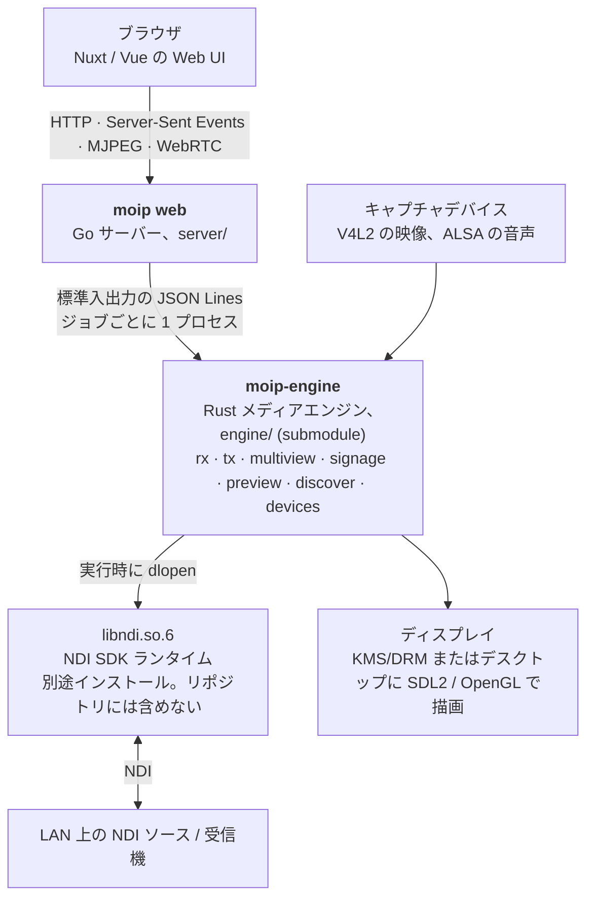

# moip-toolkit

[English](README.md) | **日本語**

[NDI](https://ndi.video/) を活用することで、DJイベント "The Utopia Tone" の映像伝送をIPネットワーク上に移行します。
NDIソースを最小限の遅延で受信して全画面表示するほか、キャプチャデバイスのNDI送信、複数ソースのマルチビュー表示、静止画のデジタルサイネージ表示ができます。いずれもブラウザUIやREST APIから遠隔操作できます。

## アーキテクチャ



- **engine/** はRustで書かれており、映像・音声処理をすべて担当します。NDI SDKを直接呼び出すので、インタプリタのロックも、受信経路でのFrameSyncによるバッファリングもありません。届いたフレームはすぐにGPUへ転送し、UYVY→RGBの変換はシェーダで行います。止まった受信機はその場で新しいものに差し替え、古いものはバックグラウンドのスレッドで破棄します。
- **server/** はGoで書かれています。Web UIとAPIを提供し、エンジンのプロセスを起動・停止します。ブラウザ向けのプレビューは再エンコードせずに中継します。[pion](https://github.com/pion/webrtc) によるWebRTCでH.264を送り、MJPEGをフォールバックにしています。
- **frontend/** はNuxt 3とVue 3で作られたブラウザUIです。

## 必要なもの

- x86_64 または arm64 の Linux
- NDI SDK のランタイム `libndi.so.6`。[NDI SDK のインストール](#ndi-sdk-のインストール)を参照してください
- mDNSでNDIソースを検出するための `avahi-daemon`
- ビルドに必要なもの：[rustup](https://rustup.rs/) で入れたstable版のRust、Go 1.24以上、C/C++コンパイラ、SDL2とALSAの開発用ヘッダ
- Web UIのビルドに必要なもの：Node.js 20以上

```bash
# Debian / Ubuntu
$ sudo apt install git curl build-essential pkg-config libsdl2-dev libasound2-dev avahi-daemon
# Fedora
$ sudo dnf install git curl gcc gcc-c++ pkgconf SDL2-devel alsa-lib-devel avahi
```

## NDI SDK のインストール

NDI SDKはVizrt NDI ABのライセンスで提供されているため、**このリポジトリにコミットしないでください**。ランタイムライブラリは、各マシンにそれぞれインストールします。moip-toolkitは起動時に `libndi.so.6` を読み込むので、ビルド自体にSDKは不要です。

同梱のスクリプトでインストールします。このスクリプトは [DistroAV の `libndi-get.sh`](https://github.com/DistroAV/DistroAV/blob/master/CI/libndi-get.sh) をもとにしています。

```bash
$ scripts/install-ndi-sdk.sh
```

スクリプトが行うこと：

1. 公式のインストーラを `https://downloads.ndi.tv/SDK/NDI_SDK_Linux/Install_NDI_SDK_v6_Linux.tar.gz` からダウンロードします。
2. NDI SDKのライセンスを表示し、同意を求めます。
3. CPUに合った `libndi.so.6*` を `sudo` で `/usr/local/lib` にコピーします。arm64では `lib/aarch64-*` のものを使います。FedoraやRHELのように、そのディレクトリがリンカの検索対象になっていない場合は登録し、最後に `ldconfig` を実行します。

環境変数で指定できるオプション：

| 変数 | 説明 |
|---|---|
| `PREFIX=/opt/ndi` | `/usr/local/lib` の代わりに `$PREFIX/lib` にインストールする |
| `NDI_ACCEPT_LICENSE=yes` | 確認なしでライセンスに同意する。既にライセンスを読んで同意している場合だけ使ってください。複数台をセットアップするときなどに使います |

[ビルド](#ビルド)の後、ランタイムが見つかることを確認します。

```bash
$ ./bin/moip version
NDI SDK LINUX ... 6.x.x
```

システム全体にインストールしたくない場合は、`NDI_RUNTIME_DIR_V6` に `libndi.so.6` のあるディレクトリを指定してください。

## ビルド

```bash
$ git clone --recurse-submodules https://github.com/TechnoTUT/moip-toolkit.git
$ cd moip-toolkit
$ make            # サーバーとCLIの bin/moip、および bin/moip-engine をビルド
$ make frontend   # Web UI を frontend/.output/public にビルド
```

エンジンは別リポジトリ [TechnoTUT/moip-engine](https://github.com/TechnoTUT/moip-engine) にあり、git submodule として `engine/` に配置されます。`--recurse-submodules` を付けずにクローンした場合は、先に `git submodule update --init` を実行してください。

`make test` でRustとGoのテストを実行できます。

## 表示の出力先

RX・マルチビュー・サイネージは、デフォルトでKMS/DRMを使ってディスプレイに直接描画します。デスクトップのコンポジタを経由しないので、1〜2フレーム分の遅延を減らせます。必要な条件は次のとおりです。

- そのディスプレイでデスクトップセッションが動いていないこと。`sudo systemctl set-default multi-user.target` でGUIを起動せずコンソールで起動する設定にできます。
- 実行ユーザーが、画面用の `video` グループとEscキー用の `input` グループに入っていること：`sudo usermod -aG video,input $USER`

出力は常に全画面になり、`WAYLAND_DISPLAY` / `DISPLAY` の指定は不要です。

デスクトップセッションがディスプレイを使っていてKMS/DRMが使えない場合は、警告を出してデスクトップ上にウィンドウを開きます。最初からデスクトップを使う場合は、`--video-driver auto`、`wayland`、`x11` のいずれかを指定してください。

> [!TIP]
> **SSH 経由で起動してデスクトップにウィンドウを表示する場合**
> SSH経由で起動したプロセスには、デスクトップセッションの環境変数が必要です。
>
> 1. セッションの種類を確認します。
>    ```bash
>    $ loginctl show-session $(loginctl | grep $(whoami) | awk '{print $1}') -p Type
>    ```
> 2. `Type=wayland` の場合：
>    ```bash
>    $ WAYLAND_DISPLAY=wayland-0 XDG_RUNTIME_DIR=/run/user/$(id -u) ./bin/moip web --video-driver auto
>    ```
> 3. `Type=x11` の場合：
>    ```bash
>    $ DISPLAY=:0 XAUTHORITY=$HOME/.Xauthority ./bin/moip web --video-driver auto
>    ```

## 使い方

`moip` コマンドが唯一の入口です。`moip web` でサーバーを起動します。それ以外のサブコマンドはメディアエンジンを直接実行します。各サブコマンドに `-h` を付けると、オプションの一覧を表示できます。

### 1. Web UI / REST API

```bash
$ ./bin/moip web --host 0.0.0.0 --port 8000
```

- ブラウザで `http://<ホスト>:8000/` を開きます。
- UIでは、ソースの検出、RXの開始と切り替え、TXの開始と停止、マルチビューとサイネージの操作、ブラウザでのプレビュー、プリセットと自動起動の設定ができます。
- 設定は `~/.config/utone-ndi/settings.json` に保存されます。サイネージ画像は `data/signage/` に保存され、場所は `--data` で変更できます。

主なオプション：

| オプション | 説明 |
|---|---|
| `--video-driver kmsdrm` | UIから起動するRX・マルチビュー・サイネージの表示ドライバ。デフォルトの `kmsdrm`、`auto`、`wayland`、`x11` から選ぶ |
| `--extra-ips 10.0.0.5,10.0.0.6` | mDNSが使えないネットワークで、これらのホストに直接ソースを問い合わせる |
| `--max-webrtc 4` | WebRTCプレビューの同時接続数の上限 |
| `--static DIR` / `--engine PATH` | UIのビルド結果や `moip-engine` の場所を指定する |

### 2. NDIソースの受信・全画面表示（RX）

```bash
$ ./bin/moip rx -s "<NDIソース名>"
```

ソースは、`HOST (STREAM)` 形式のフルネームでも、ストリーム名だけでも指定できます。`-s` を省略するとネットワーク上を検索し、一覧から選んで起動できます。`Esc` キーで終了します。

その他のオプション：

| オプション | 説明 |
|---|---|
| `--recv-fmt uyvy` | 受信形式。デフォルトの `uyvy` はGPUで変換するので最速。`rgb`、`bgr` も選べる |
| `--recv-bandwidth highest` | `highest` または `lowest` |
| `--banner-seconds 30` | IPアドレスのバナーを表示する秒数 |
| `--fullscreen` | デスクトップ上で全画面にする。KMS/DRMでは常に全画面 |

### 3. キャプチャデバイスの送信（TX）

```bash
$ ./bin/moip devices      # カメラ、キャプチャボード、音声入力の一覧
$ ./bin/moip tx -n TX -d 0 --width 1920 --height 1080 --fps 30 -a "plughw:CARD=PCH,DEV=0"
$ ./bin/moip tx -n BARS -d -1 --fps 59.94 --no-audio   # 時計付きのカラーバー
```

- `-d` には、`/dev/videoN` を表すV4L2デバイスの番号、デバイスのパス、内蔵テストパターンを表す `-1` のいずれかを指定します。
- `--input-format auto|yuyv|uyvy|mjpg` でキャプチャ形式を選びます。`auto` は、要求した解像度とフレームレートをデバイスが非圧縮で出せる場合は非圧縮を使い、出せない場合はMJPEGを使います。
- 映像は常にNDIのネイティブ形式であるUYVYで送信します。音声はALSAから取り込み、`-a default` でシステムの既定の入力を使います。

### 4. マルチビュー

```bash
$ ./bin/moip multiview                   # 検出したすべてのソースを、増減に合わせて並べ直して表示
$ ./bin/moip multiview -s CAM1 -s CAM2   # 指定したソースだけ
```

各タイルにはソース名とL/Rの音声メーターを表示します。タイルが3枚以上のときは、CPU負荷を抑えるためにNDIの低帯域なプロキシストリームを使います。`--recv-bandwidth highest` を指定すると、常に最高画質で受信します。

### 5. デジタルサイネージ

Web UIから画像をアップロードし、接続したディスプレイに全画面表示します。コマンドラインから画像を指定して表示することもできます。

```bash
$ ./bin/moip signage /path/to/image.png
$ ./bin/moip signage /path/to/image.png --framebuffer   # Linux フレームバッファに表示。GPU 不要
```

フレームバッファのデバイスは `--fb-device` で指定でき、デフォルトは `/dev/fb0` です。フレームバッファへの書き込みには `video` グループへの所属が必要です。

## systemd による自動起動

`systemd-example/` に、ユーザーユニットの例として `moip-rx.service`、`moip-tx.service`、`moip-web.service` があります。`ExecStart` を環境に合わせて編集してください。

```bash
$ mkdir -p ~/.config/systemd/user
$ cp systemd-example/moip-rx.service ~/.config/systemd/user/
$ vim ~/.config/systemd/user/moip-rx.service
$ systemctl --user daemon-reload
$ systemctl --user enable --now moip-rx.service
```

ログインせずに起動時から動かすには、lingerを有効にします。

```bash
$ sudo loginctl enable-linger $USER
```

`moip-web.service` を使う場合は、代わりにWeb UIの設定でRX / TXの自動起動を有効にすることもできます。

## REST API

すべてのエンドポイントは `/api` 以下にあります。エラーは `{"detail": "..."}` の形式で返します。

| メソッド | パス | 説明 |
|---|---|---|
| GET | `/api/events` | 状態全体を送るServer-Sent Events。`sources`、`rx`、`tx`、`multiview`、`signage`、`system`、`settings` を、変化があったときに送る |
| GET | `/api/ndi/sources` | ネットワーク上で見つかったソース |
| GET | `/api/ndi/preview?source=&fps=&width=` | MJPEGプレビュー |
| POST | `/api/webrtc/offer` | WebRTCプレビュー。`{source, sdp, type}` を送ると、H.264トラック付きのSDPアンサーを返す |
| GET | `/api/devices/video`、`/api/devices/audio` | キャプチャデバイス |
| GET/POST | `/api/rx/status`、`/api/rx/start`、`/api/rx/switch`、`/api/rx/stop` | 受信 |
| GET/POST | `/api/tx/status`、`/api/tx/start`、`/api/tx/stop` | 送信 |
| GET/POST | `/api/multiview/status`、`/api/multiview/start`、`/api/multiview/stop` | マルチビュー |
| GET/POST/DELETE | `/api/signage/images`、`/api/signage/upload`、`/api/signage/image/{filename}` | サイネージ画像 |
| GET/POST | `/api/signage/status`、`/api/signage/start`、`/api/signage/stop` | サイネージの表示 |
| GET/POST | `/api/system/status`、`/api/settings` | システム負荷、プリセットと自動起動 |

RX・マルチビュー・サイネージはディスプレイを共有するため、どれかを起動すると他は停止します。

## ディレクトリ構成

```
moip-toolkit/
├── engine/                 # Rust ワークスペース (submodule: TechnoTUT/moip-engine)
│   ├── ndi/                # 実行時に読み込む NDI SDK バインディング
│   └── src/                # moip-engine バイナリ
│       ├── rx.rs           # 全画面ビューア
│       ├── recv.rs         # キャプチャスレッド、ストール時の復旧、音声メーター
│       ├── gfx.rs          # SDL2/OpenGL ウィンドウ、UYVY シェーダ、ラベル
│       ├── tx.rs           # 送信。V4L2 またはテストパターンと ALSA
│       ├── multiview.rs    # グリッド表示
│       ├── signage.rs      # GL またはフレームバッファへの画像表示
│       ├── preview.rs      # ブラウザ向けの H.264 / JPEG プレビュー
│       └── control.rs      # サーバーとの標準入出力 JSON プロトコル
├── server/                 # Go モジュール
│   ├── cmd/moip/           # moip コマンド。Web サーバーとエンジンの起動
│   └── internal/           # api, jobs, preview, sources, settings, sysmon, engine
├── frontend/               # Nuxt 3 / Vue 3 の Web UI
├── scripts/                # install-ndi-sdk.sh
├── data/signage/           # アップロードされたサイネージ画像
├── systemd-example/        # systemd ユーザーユニットの例
└── Makefile
```

## ライセンス

moip-toolkitは [MIT License](LICENSE) で公開しています。NDI SDKとランタイムはNDI SDKのライセンスに従い、このリポジトリには含まれません。NDI® はVizrt NDI ABの登録商標です。
