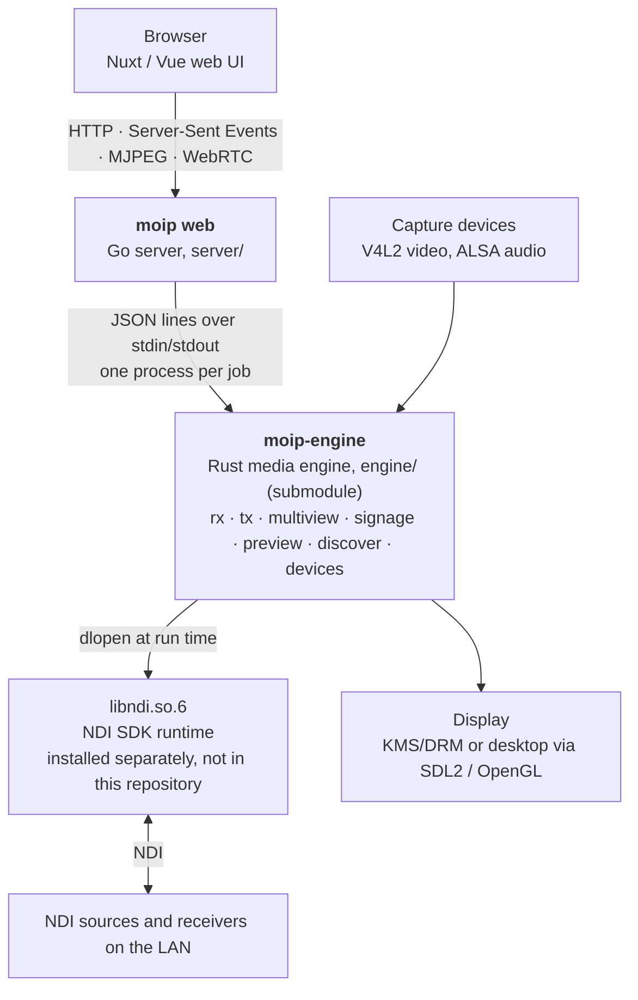

# moip-toolkit

**English** | [日本語](README.ja.md)

moip-toolkit moves the video transport of the DJ event "The Utopia Tone" onto an IP network using [NDI](https://ndi.video/).
It receives NDI sources and shows them fullscreen with minimal latency, sends capture devices as NDI sources, shows several sources in a multiview grid, and displays still images as digital signage. Everything can be controlled from a browser UI or a REST API.

## Architecture



- **engine/** is written in Rust and does all the media work. It calls the NDI SDK directly, so there is no interpreter lock and no framesync buffering in the receive path: frames are uploaded to the GPU as soon as they arrive, and UYVY is converted to RGB in a shader. A stalled receiver is replaced at once and the old one is torn down on a background thread.
- **server/** is written in Go. It serves the web UI and API, starts and stops engine processes, and forwards browser previews without transcoding them: H.264 over WebRTC via [pion](https://github.com/pion/webrtc), with MJPEG as a fallback.
- **frontend/** is the browser UI, built with Nuxt 3 and Vue 3.

## Requirements

- Linux on x86_64 or arm64
- The NDI SDK runtime `libndi.so.6`, see [Install the NDI SDK](#install-the-ndi-sdk)
- `avahi-daemon`, so that NDI sources can be discovered over mDNS
- To build: stable Rust installed with [rustup](https://rustup.rs/), Go 1.24 or newer, a C/C++ compiler, and the SDL2 and ALSA development headers
- To build the web UI: Node.js 20 or newer

```bash
# Debian / Ubuntu
$ sudo apt install git curl build-essential pkg-config libsdl2-dev libasound2-dev avahi-daemon
# Fedora
$ sudo dnf install git curl gcc gcc-c++ pkgconf SDL2-devel alsa-lib-devel avahi
```

## Install the NDI SDK

The NDI SDK is licensed by Vizrt NDI AB and **must not be committed to this repository**. Each machine needs its own copy of the runtime library. moip-toolkit does not need the SDK to build: it loads `libndi.so.6` when it starts.

Install it with the bundled script, which is based on [DistroAV's `libndi-get.sh`](https://github.com/DistroAV/DistroAV/blob/master/CI/libndi-get.sh):

```bash
$ scripts/install-ndi-sdk.sh
```

The script:

1. downloads the official installer from `https://downloads.ndi.tv/SDK/NDI_SDK_Linux/Install_NDI_SDK_v6_Linux.tar.gz`;
2. shows the NDI SDK license and asks you to accept it;
3. copies `libndi.so.6*` for your CPU to `/usr/local/lib` with `sudo`. On arm64 the library is taken from `lib/aarch64-*`. If the dynamic linker does not search that directory yet, as on Fedora and RHEL, the script registers it, then runs `ldconfig`.

Options, set as environment variables:

| Variable | Description |
|---|---|
| `PREFIX=/opt/ndi` | Install to `$PREFIX/lib` instead of `/usr/local/lib` |
| `NDI_ACCEPT_LICENSE=yes` | Accept the license without the prompt. Only use this after you have read and accepted it, for example when setting up more machines |

After [building](#build), check that the runtime is found:

```bash
$ ./bin/moip version
NDI SDK LINUX ... 6.x.x
```

If you would rather not install system-wide, point `NDI_RUNTIME_DIR_V6` at the directory that contains `libndi.so.6`.

## Build

```bash
$ git clone --recurse-submodules https://github.com/TechnoTUT/moip-toolkit.git
$ cd moip-toolkit
$ make            # builds bin/moip, the server and CLI, and bin/moip-engine
$ make frontend   # builds the web UI into frontend/.output/public
```

The engine lives in its own repository, [TechnoTUT/moip-engine](https://github.com/TechnoTUT/moip-engine), and is checked out at `engine/` as a git submodule. If you cloned without `--recurse-submodules`, run `git submodule update --init` first.

`make test` runs the Rust and Go tests.

## Display output

RX, multiview and signage render straight to the display through KMS/DRM by default. Bypassing the desktop compositor saves one to two frames of latency. This needs:

- no desktop session running on that display. `sudo systemctl set-default multi-user.target` makes the machine boot to a console instead of a GUI;
- the user in the `video` group for the display and the `input` group for the Esc key: `sudo usermod -aG video,input $USER`.

Output is always fullscreen, and `WAYLAND_DISPLAY` / `DISPLAY` are not needed.

If KMS/DRM is not available because a desktop session owns the display, moip-toolkit prints a warning and opens a window on the desktop instead. To use the desktop from the start, pass `--video-driver auto`, `wayland` or `x11`.

> [!TIP]
> **Showing windows on a desktop when started over SSH**
> A process started over SSH needs the desktop session's environment variables.
>
> 1. Check the session type:
>    ```bash
>    $ loginctl show-session $(loginctl | grep $(whoami) | awk '{print $1}') -p Type
>    ```
> 2. For `Type=wayland`:
>    ```bash
>    $ WAYLAND_DISPLAY=wayland-0 XDG_RUNTIME_DIR=/run/user/$(id -u) ./bin/moip web --video-driver auto
>    ```
> 3. For `Type=x11`:
>    ```bash
>    $ DISPLAY=:0 XAUTHORITY=$HOME/.Xauthority ./bin/moip web --video-driver auto
>    ```

## Usage

The `moip` command is the single entry point. `moip web` starts the server. The other subcommands run the media engine directly, and each one accepts `-h` to list its options.

### 1. Web UI / REST API

```bash
$ ./bin/moip web --host 0.0.0.0 --port 8000
```

- Open `http://<host>:8000/` in a browser.
- The UI lets you discover sources, start and switch RX, start and stop TX, run multiview and signage, preview sources in the browser, and set presets with auto-start.
- Settings are stored in `~/.config/utone-ndi/settings.json`. Signage images are stored in `data/signage/`; change the location with `--data`.

Useful flags:

| Flag | Description |
|---|---|
| `--video-driver kmsdrm` | Display driver for RX, multiview and signage started from the UI: `kmsdrm` by default, `auto`, `wayland` or `x11` |
| `--extra-ips 10.0.0.5,10.0.0.6` | Query these hosts for sources directly, for networks without mDNS |
| `--max-webrtc 4` | Maximum number of concurrent WebRTC previews |
| `--node-id <id>` | ID this node reports to a controller. Defaults to the hostname, so give every node a unique hostname |
| `--advertise=false` | Do not advertise the node over mDNS |
| `--static DIR` / `--engine PATH` | Override where the UI build and `moip-engine` are found |

While `moip web` runs it advertises itself as `_moip._tcp` through `avahi-daemon` (over D-Bus), with the TXT records `id`, `hostname` and `version`, so that a controller such as [moipctl](https://github.com/TechnoTUT/moipctl) can find it without knowing its IP address. If `avahi-daemon` is not running yet, or restarts, the registration is retried.

### 2. Receive and display a source (RX)

```bash
$ ./bin/moip rx -s "<NDI source name>"
```

Give the source as its full name, `HOST (STREAM)`, or as the stream name only. If you leave out `-s`, the network is searched and you pick a source from a list. Press `Esc` to quit.

Other options:

| Option | Description |
|---|---|
| `--recv-fmt uyvy` | Receive format: `uyvy`, the default and fastest because it is converted on the GPU, `rgb` or `bgr` |
| `--recv-bandwidth highest` | `highest` or `lowest` |
| `--banner-seconds 30` | How long the IP address banner is shown |
| `--fullscreen` | Fullscreen window on a desktop. KMS/DRM output is always fullscreen |

### 3. Send a capture device (TX)

```bash
$ ./bin/moip devices      # list cameras, capture cards and audio inputs
$ ./bin/moip tx -n TX -d 0 --width 1920 --height 1080 --fps 30 -a "plughw:CARD=PCH,DEV=0"
$ ./bin/moip tx -n BARS -d -1 --fps 59.94 --no-audio   # colour bars with a clock
```

- `-d` takes a V4L2 device index for `/dev/videoN`, a device path, or `-1` for the built-in test pattern.
- `--input-format auto|yuyv|uyvy|mjpg` picks the capture format. `auto` uses uncompressed video when the device can deliver the requested size and frame rate, and MJPEG otherwise.
- Video is always sent as UYVY, NDI's native format. Audio comes from ALSA; `-a default` uses the system default input.

### 4. Multiview

```bash
$ ./bin/moip multiview                   # every source found, re-arranged as sources come and go
$ ./bin/moip multiview -s CAM1 -s CAM2   # only these sources
```

Each tile shows the source name and L/R audio meters. With more than two tiles, the low-bandwidth NDI proxy streams are used to save CPU; `--recv-bandwidth highest` overrides this.

### 5. Digital signage

Upload images in the web UI and show them fullscreen on the connected display, or show an image from the command line:

```bash
$ ./bin/moip signage /path/to/image.png
$ ./bin/moip signage /path/to/image.png --framebuffer   # Linux framebuffer, no GPU needed
```

`--fb-device` selects the framebuffer device, `/dev/fb0` by default. Writing to the framebuffer requires membership of the `video` group.

## Autostart with systemd

Example user units are in `systemd-example/`: `moip-rx.service`, `moip-tx.service` and `moip-web.service`. Edit `ExecStart` to match your setup.

```bash
$ mkdir -p ~/.config/systemd/user
$ cp systemd-example/moip-rx.service ~/.config/systemd/user/
$ vim ~/.config/systemd/user/moip-rx.service
$ systemctl --user daemon-reload
$ systemctl --user enable --now moip-rx.service
```

To start the units at boot without logging in, enable lingering:

```bash
$ sudo loginctl enable-linger $USER
```

With `moip-web.service`, you can instead turn on auto-start for RX / TX in the web UI's settings.

## REST API

All endpoints are under `/api`. Errors are returned as `{"detail": "..."}`.

| Method | Path | Description |
|---|---|---|
| GET | `/api/events` | Server-Sent Events carrying the full state: `sources`, `rx`, `tx`, `multiview`, `signage`, `system` and `settings`. Sent when it changes |
| GET | `/api/ndi/sources` | Sources found on the network |
| GET | `/api/ndi/preview?source=&fps=&width=` | MJPEG preview |
| POST | `/api/webrtc/offer` | WebRTC preview: send `{source, sdp, type}`, receive an SDP answer with an H.264 track |
| GET | `/api/devices/video`, `/api/devices/audio` | Capture devices |
| GET/POST | `/api/rx/status`, `/api/rx/start`, `/api/rx/switch`, `/api/rx/stop` | Receiver |
| GET/POST | `/api/tx/status`, `/api/tx/start`, `/api/tx/stop` | Sender |
| GET/POST | `/api/multiview/status`, `/api/multiview/start`, `/api/multiview/stop` | Multiview |
| GET/POST/DELETE | `/api/signage/images`, `/api/signage/upload`, `/api/signage/image/{filename}` | Signage images |
| GET/POST | `/api/signage/status`, `/api/signage/start`, `/api/signage/stop` | Signage display |
| GET/POST | `/api/system/status`, `/api/settings` | System load, presets and auto-start |
| GET | `/api/node/info` | `id`, `hostname`, `version` and `roles` of this node, for a controller |

RX, multiview and signage share the display, so starting one of them stops the others.

## Repository layout

```
moip-toolkit/
├── engine/                 # Rust workspace (submodule: TechnoTUT/moip-engine)
│   ├── ndi/                # NDI SDK bindings, loaded at run time
│   └── src/                # moip-engine binary
│       ├── rx.rs           # fullscreen viewer
│       ├── recv.rs         # capture thread, stall recovery, audio meter
│       ├── gfx.rs          # SDL2/OpenGL window, UYVY shader, labels
│       ├── tx.rs           # sender: V4L2 or test pattern, plus ALSA
│       ├── multiview.rs    # grid viewer
│       ├── signage.rs      # image display on GL or the framebuffer
│       ├── preview.rs      # H.264 / JPEG preview for the browser
│       └── control.rs      # stdin/stdout JSON protocol with the server
├── server/                 # Go module
│   ├── cmd/moip/           # moip command: web server and engine launcher
│   └── internal/           # api, jobs, preview, sources, settings, sysmon, engine
├── frontend/               # Nuxt 3 / Vue 3 web UI
├── scripts/                # install-ndi-sdk.sh
├── data/signage/           # uploaded signage images
├── systemd-example/        # example systemd user units
└── Makefile
```

## License

moip-toolkit is released under the [MIT License](LICENSE). The NDI SDK and runtime are subject to the NDI SDK license and are not part of this repository. NDI® is a registered trademark of Vizrt NDI AB.
