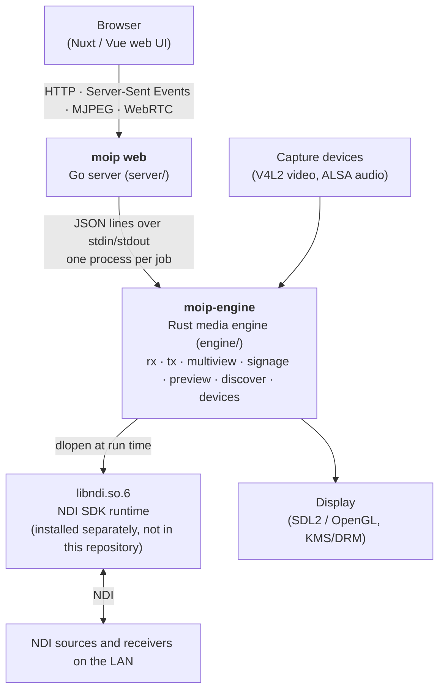

# moip-toolkit

**English** | [日本語](README.ja.md)

moip-toolkit moves the video transport of the DJ event "The Utopia Tone" onto an IP network using [NDI](https://ndi.video/).
It receives NDI sources and shows them fullscreen with minimal latency, sends capture devices as NDI sources, shows several sources in a multiview grid, and displays still images as digital signage. Everything can be controlled from a browser UI or a REST API.

## Architecture



- **engine/** (Rust) does all the media work. It calls the NDI SDK directly, so there is no interpreter lock and no framesync buffering in the receive path: frames are uploaded to the GPU as soon as they arrive, and UYVY is converted to RGB in a shader. A stalled receiver is replaced at once and the old one is torn down on a background thread.
- **server/** (Go) serves the web UI and API, starts and stops engine processes, and forwards browser previews (H.264 over WebRTC via [pion](https://github.com/pion/webrtc), with an MJPEG fallback) without transcoding them.
- **frontend/** (Nuxt 3 / Vue 3) is the browser UI.

## Requirements

- Linux (x86_64 or arm64)
- The NDI SDK runtime `libndi.so.6` (see [Install the NDI SDK](#install-the-ndi-sdk))
- `avahi-daemon`, so that NDI sources can be discovered over mDNS
- To build: Rust (stable, via [rustup](https://rustup.rs/)), Go 1.24 or newer, a C/C++ compiler, and the SDL2 and ALSA development headers
- To build the web UI: Node.js 20 or newer

```bash
# Debian / Ubuntu
$ sudo apt install git build-essential pkg-config libsdl2-dev libasound2-dev avahi-daemon
# Fedora
$ sudo dnf install git gcc gcc-c++ pkgconf SDL2-devel alsa-lib-devel avahi
```

## Install the NDI SDK

The NDI SDK is licensed by Vizrt NDI AB and **must not be committed to this repository**. Each machine needs its own copy of the runtime library. moip-toolkit does not need the SDK to build: it loads `libndi.so.6` when it starts.

1. Download **NDI SDK for Linux** from <https://ndi.video/for-developers/ndi-sdk/> (you have to register).
2. Extract the archive and run the installer. It asks you to accept the license, then creates a directory named `NDI SDK for Linux`:
   ```bash
   $ tar -xzf Install_NDI_SDK_v6_Linux.tar.gz
   $ ./Install_NDI_SDK_v6_Linux.sh
   ```
3. Copy the runtime library for your CPU into the library path. Use `x86_64-linux-gnu` on PCs; on arm64 boards, use the matching `aarch64-*` directory under `lib/`.
   ```bash
   $ sudo cp -P "NDI SDK for Linux/lib/x86_64-linux-gnu/"libndi.so.6* /usr/local/lib/
   $ sudo ldconfig
   ```
4. Check that the runtime is found (after [building](#build)):
   ```bash
   $ ./bin/moip version
   NDI SDK LINUX ... 6.x.x
   ```

If you would rather not install system-wide, point `NDI_RUNTIME_DIR_V6` at the directory that contains `libndi.so.6`.

## Build

```bash
$ git clone https://github.com/TechnoTUT/moip-toolkit.git
$ cd moip-toolkit
$ make            # builds bin/moip (server and CLI) and bin/moip-engine
$ make frontend   # builds the web UI into frontend/.output/public
```

`make test` runs the Rust and Go tests.

## Usage

The `moip` command is the single entry point. `moip web` starts the server. The other subcommands run the media engine directly, and each one accepts `-h` to list its options.

### 1. Web UI / REST API

```bash
$ ./bin/moip web --host 0.0.0.0 --port 8000
```

- Browser UI: `http://<host>:8000/`
- The UI lets you discover sources, start and switch RX, start and stop TX, run multiview and signage, preview sources in the browser, and set presets with auto-start.
- Settings are stored in `~/.config/utone-ndi/settings.json`. Signage images are stored in `data/signage/`; change the location with `--data`.

Useful flags:

| Flag | Description |
|---|---|
| `--video-driver kmsdrm` | Display driver for RX, multiview and signage started from the UI (`auto`, `kmsdrm`, `wayland`, `x11`) |
| `--extra-ips 10.0.0.5,10.0.0.6` | Query these hosts for sources directly, for networks without mDNS |
| `--max-webrtc 4` | Maximum number of concurrent WebRTC previews |
| `--static DIR` / `--engine PATH` | Override where the UI build and `moip-engine` are found |

> [!TIP]
> **Starting the server over SSH**
> To show RX windows on the machine's own desktop, the server needs access to the display server.
>
> 1. Check the session type:
>    ```bash
>    $ loginctl show-session $(loginctl | grep $(whoami) | awk '{print $1}') -p Type
>    ```
> 2. Wayland (`Type=wayland`):
>    ```bash
>    $ WAYLAND_DISPLAY=wayland-0 XDG_RUNTIME_DIR=/run/user/$(id -u) ./bin/moip web
>    ```
> 3. X11 (`Type=x11`):
>    ```bash
>    $ DISPLAY=:0 XAUTHORITY=$HOME/.Xauthority ./bin/moip web
>    ```
>
> None of this is needed with `--video-driver kmsdrm`.

### 2. Receive and display a source (RX)

```bash
$ ./bin/moip rx -s "<NDI source name>" --fullscreen
```

The source can be given as its full name (`HOST (STREAM)`) or as the stream name only. If you leave out `-s`, the network is searched and you pick a source from a list. Press `Esc` to quit.

> [!TIP]
> **Lowest latency: direct KMS/DRM output**
> On a dedicated RX machine, drawing straight to the display instead of through the desktop compositor (Wayland / X11) saves one to two frames of latency.
> ```bash
> $ ./bin/moip rx -s "<NDI source name>" --video-driver kmsdrm
> $ ./bin/moip web --video-driver kmsdrm   # also applies to RX / multiview / signage started from the UI
> ```
> - No desktop session may be running on that display (console / TTY). `sudo systemctl set-default multi-user.target` makes the machine boot without a GUI.
> - Add the user to the `video` (display) and `input` (Esc key) groups: `sudo usermod -aG video,input $USER`
> - Output is always fullscreen, and `WAYLAND_DISPLAY` / `DISPLAY` are not needed.

Other options: `--recv-fmt uyvy|rgb|bgr` (default `uyvy`: converted on the GPU, the fastest), `--recv-bandwidth highest|lowest`, `--banner-seconds` (how long the IP banner is shown).

### 3. Send a capture device (TX)

```bash
$ ./bin/moip devices                      # list cameras / capture cards and audio inputs
$ ./bin/moip tx -n TX -d 0 --width 1920 --height 1080 --fps 30 -a "plughw:CARD=PCH,DEV=0"
$ ./bin/moip tx -n BARS -d -1 --fps 59.94 --no-audio   # colour bars with a clock
```

- `-d` takes a V4L2 device index (`/dev/videoN`), a device path, or `-1` for the built-in test pattern.
- `--input-format auto|yuyv|uyvy|mjpg` picks the capture format. `auto` uses uncompressed video when the device can deliver the requested size and frame rate, and MJPEG otherwise.
- Video is always sent as UYVY, NDI's native format. Audio comes from ALSA; `-a default` uses the system default input.

### 4. Multiview

```bash
$ ./bin/moip multiview --fullscreen          # every source found, re-arranged as sources come and go
$ ./bin/moip multiview -s CAM1 -s CAM2       # only these sources
```

Each tile shows the source name and L/R audio meters. With more than two tiles, the low-bandwidth NDI proxy streams are used to save CPU (`--recv-bandwidth highest` overrides this).

### 5. Digital signage

Upload images in the web UI and show them fullscreen on the connected display, or show an image from the command line:

```bash
$ ./bin/moip signage /path/to/image.png --fullscreen
$ ./bin/moip signage /path/to/image.png --framebuffer   # Linux framebuffer, no GUI/GL needed
```

`--fb-device` selects the framebuffer device (default `/dev/fb0`). Writing to the framebuffer requires membership of the `video` group.

## Autostart (systemd)

Example user units are in `systemd-example/`: `ndi-rx.service`, `ndi-tx.service` and `ndi-web.service`. Edit `ExecStart` to match your setup.

```bash
$ mkdir -p ~/.config/systemd/user
$ cp systemd-example/ndi-rx.service ~/.config/systemd/user/
$ vim ~/.config/systemd/user/ndi-rx.service
$ systemctl --user daemon-reload
$ systemctl --user enable --now ndi-rx.service
```

To start the units at boot without logging in, enable lingering:

```bash
$ sudo loginctl enable-linger $USER
```

With `ndi-web.service`, you can instead turn on auto-start for RX / TX in the web UI's settings.

## REST API

All endpoints are under `/api`. Errors are returned as `{"detail": "..."}`.

| Method | Path | Description |
|---|---|---|
| GET | `/api/events` | Server-Sent Events: the full state (`sources`, `rx`, `tx`, `multiview`, `signage`, `system`, `settings`), sent when it changes |
| GET | `/api/ndi/sources` | Sources found on the network |
| GET | `/api/ndi/preview?source=&fps=&width=` | MJPEG preview |
| POST | `/api/webrtc/offer` | WebRTC preview (`{source, sdp, type}` → SDP answer with an H.264 track) |
| GET | `/api/devices/video`, `/api/devices/audio` | Capture devices |
| GET/POST | `/api/rx/status`, `/api/rx/start`, `/api/rx/switch`, `/api/rx/stop` | Receiver |
| GET/POST | `/api/tx/status`, `/api/tx/start`, `/api/tx/stop` | Sender |
| GET/POST | `/api/multiview/status`, `/api/multiview/start`, `/api/multiview/stop` | Multiview |
| GET/POST/DELETE | `/api/signage/...` | Signage images (`images`, `upload`, `image/{filename}`) and display (`start`, `stop`, `status`) |
| GET/POST | `/api/system/status`, `/api/settings` | System load, presets and auto-start |

Changes from the previous Python version:

- Audio inputs are ALSA device ids: `/api/devices/audio` returns `id` instead of `index`, and `audio_device` in TX requests and settings is a string. An old settings file still loads, but you need to choose the audio device again.
- `pix_fmt` is gone (video is always sent as UYVY). The new `input_format` field (`auto`, `yuyv`, `uyvy`, `mjpg`) selects the capture format.
- New status fields. RX: `fps_recv`, `skipped_frames`, `video_driver`. TX: `input_format`, `connections`, `dropped_frames`. Multiview: `auto_discovery`. Signage: `output`.
- RX, multiview and signage share the display, so starting one of them stops the others.

## Repository layout

```
moip-toolkit/
├── engine/                 # Rust workspace
│   ├── ndi/                # NDI SDK bindings (runtime-loaded, hand-written FFI)
│   └── moip-engine/src/
│       ├── rx.rs           # fullscreen viewer
│       ├── recv.rs         # capture thread, stall recovery, audio meter
│       ├── gfx.rs          # SDL2/OpenGL window, UYVY shader, labels
│       ├── tx.rs           # sender (V4L2 / test pattern + ALSA)
│       ├── multiview.rs    # grid viewer
│       ├── signage.rs      # image display (GL or framebuffer)
│       ├── preview.rs      # H.264 / JPEG preview for the browser
│       └── control.rs      # stdin/stdout JSON protocol with the server
├── server/                 # Go module
│   ├── cmd/moip/           # moip command (web server + engine launcher)
│   └── internal/           # api, jobs, preview (WebRTC/MJPEG), sources, settings, sysmon, engine
├── frontend/               # Nuxt 3 / Vue 3 web UI
├── data/signage/           # uploaded signage images
├── systemd-example/        # example systemd user units
└── Makefile
```

## License

MIT (see [LICENSE](LICENSE)). The NDI SDK and runtime are subject to the NDI SDK license and are not part of this repository. NDI® is a registered trademark of Vizrt NDI AB.
